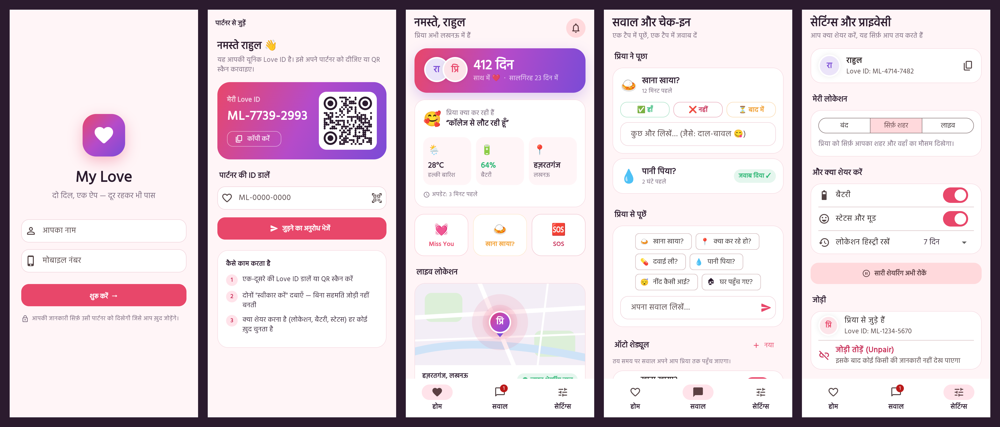

# My Love ❤️

कपल के लिए मोबाइल ऐप (Android + iPhone), Flutter में।
दोनों पार्टनर अपनी यूनिक **Love ID** से जुड़ते हैं और एक-दूसरे का शहर, मौसम,
स्टेटस, बैटरी और (अनुमति से) लाइव लोकेशन देखते हैं। "खाना खाया?" जैसे सवाल
एक टैप में या तय समय पर अपने आप भेजे जा सकते हैं।



## अभी क्या बना है (चरण 1, डेमो डेटा के साथ)

| स्क्रीन | क्या है |
|---|---|
| स्वागत | नाम और मोबाइल नंबर, फिर यूनिक Love ID बनती है |
| पार्टनर से जुड़ें | अपनी ID और QR कोड, पार्टनर की ID डालना। गलत ID तुरंत पकड़ी जाती है। सामने वाले के Accept करने पर ही जोड़ी बनती है |
| होम | साथ के दिन, पार्टनर का स्टेटस और मूड, शहर का मौसम, बैटरी, लोकेशन, Miss You / खाना खाया? / SOS, अपना मूड और स्टेटस |
| सवाल | पार्टनर के सवालों का जवाब (हाँ / नहीं / बाद में, साथ में नोट), सवाल भेजना, रोज़ के ऑटो-शेड्यूल |
| सेटिंग्स | लोकेशन बंद / सिर्फ़ शहर / लाइव (पुष्टि के साथ), बैटरी और स्टेटस शेयरिंग, हिस्ट्री कितने दिन रहे, एक बटन से सारी शेयरिंग रोकना, जोड़ी तोड़ना |

### Love ID
फ़ॉर्मेट `ML-1234-5670`। आख़िरी अंक चेक-डिजिट है, इसलिए एक अंक गलत टाइप होने पर
ID "गलत" दिखती है और गलत व्यक्ति को अनुरोध नहीं जाता। कोड: `lib/data/love_id.dart`।

### प्राइवेसी के नियम (डिज़ाइन में शामिल)
- बिना दोनों की सहमति के जोड़ी नहीं बनती।
- लाइव लोकेशन चालू करने से पहले पुष्टि माँगी जाती है, और शेयरिंग कभी भी बंद की जा सकती है।
- ऐप छिपकर ट्रैक नहीं करता। Google Play / App Store की नीतियाँ भी यही माँगती हैं।

## चलाना

```bash
flutter pub get
flutter run                 # जुड़े हुए फ़ोन या इम्युलेटर पर
flutter test                # टेस्ट
flutter build apk           # Android APK
flutter build web --release --no-web-resources-cdn   # वेब डेमो
```

वेब डेमो में कोई भी स्क्रीन सीधे खोलने के लिए:
`?demo=pair`, `?demo=home`, `?demo=questions`, `?demo=settings`।

## कोड कहाँ है

```
lib/
  main.dart              ऐप और स्क्रीन बदलने का तर्क
  theme.dart             रंग, फ़ॉन्ट (Hind), बटन और कार्ड की शैली
  data/love_id.dart      यूनिक ID बनाना और जाँचना
  data/app_state.dart    ऐप की स्थिति (अभी डेमो डेटा)
  screens/               welcome, pair, home, dashboard, questions, settings
  widgets/               साझा विजेट, नक्शे का चित्र
```

## अगले चरण
1. **Supabase बैकएंड**: OTP लॉगिन, यूज़र और जोड़ी की टेबल, रियल-टाइम स्टेटस, सवाल-जवाब।
2. **असली डेटा**: GPS (`geolocator`), बैटरी, OpenWeatherMap से मौसम, Google Maps।
3. **नोटिफ़िकेशन**: Firebase Cloud Messaging; ऑटो-शेड्यूल सवाल सर्वर से तय समय पर।
4. **बैकग्राउंड लोकेशन** के लिए Android और iOS की अनुमतियाँ, लगातार दिखने वाली सूचना के साथ।
